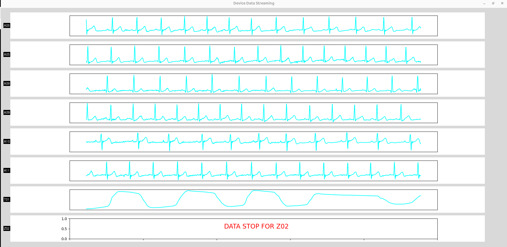

.. _usage:

=====
Usage
=====

* This page will present the use case of this python package, along with examples of how to use it.

Use Case
========

* The goal of this package is to collect data streamed via bluetooth from a Polar H10 Device, write the data, and visualize it in real time.

* The connection to the Polar H10, the start and stop of the streaming are handled by `bleakheart`_ 

.. _bleakheart: https://github.com/fsmeraldi/bleakheart

Usage
=====

Configuration file
------------------

* The heart_sync.py is used to launch one ECG stream. 

* To run heart_sync.py you first need a csv configuration file. The expected format is:
    - the first line should be a header with the following fields: POLAR_ID,POLAR_SN,QUIT_PORT,TRIGGER_PORT,OUTPUT_FILE,DONGLE_MAC
    - POLAR_ID is an arbitrary ID given to the polar device,
    - POLAR_SN is the serial number of the polar device,
    - TRIGGER_PORT is an available port on the computer used to run the software. This port will be used to send a trigger via UDP to signal an event occuring during the stream. The trigger port need to be different for each polar_id listed.
    - QUIT_PORT is an available port on the computer used to run the software. This port will be used to send a trigger via UDP to stop the stream. The quit_port needs to be different for each polar_id listed.
    - OUTPUT_FILE is the name given to the text file in which the ECG stream is written,
    - DONGLE_MAC can be used to specify the MAC address of the bluetooth dongle used to receive the ECG stream on the computer. The dongle_mac can be the same for multiple polar_id, but should not exceed the limit of devices that can be connected to this dongle (usually the limit is around 7 devices max).
    

Launch one or multiple streams
------------------------------

* To launch a stream on a Polar device, this device must be listed in the configuration file, with both its serial number and an arbitrary ID (for example "A03").

* Once the configuration file config.csv is filled, you can launch the stream in a terminal window, from the root folder of this package, using::

    python heart_sync/heart_sync.py -c config.csv -p A03

* You can use one configuration file to list multiple polar devices, in that case you can then run several stream by using the command above in separate terminal windows, one for each polar device. 

* heart_sync.py records everything (connection, disconnection, triggers..) into a file called experiment.log

Send trigger
------------

* In the root folder of the package, you can use trigger_sender.py to send event trigger or quit triggers to one ECG stream or to all streams.

* To send an event trigger to polar device with ID A03::

    python trigger_sender.py -c config.csv -p A03 

* To send a quit trigger to device A03::

    python trigger_sender.py -c config.csv -p A03 -q 

* To send an event trigger (or quit trigger) to all devices::

    python trigger_sender.py -c config.csv -p ALL 
    python trigger_sender.py -c config.csv -p ALL -q 

Visualise the streams
---------------------

* While one or several stream are ongoing, ecg_visualiser.py can be used to plot in real time all the streams. To use it::

    python ecg_visualiser.py

* When a stream stops for more than 1 second, the plot will instead display "DATA STOP FOR " with the ID of the polar device concerned. 

   Example of visualisation with 7 working ECG streams and one failing.

Cleaning the experiment folder
------------------------------

* At the end of the experiment, you can run::

    python start_experiment.py

* start_experiment.py archives the experiment log file and empties the local configuration file used by the visualisation utility.
