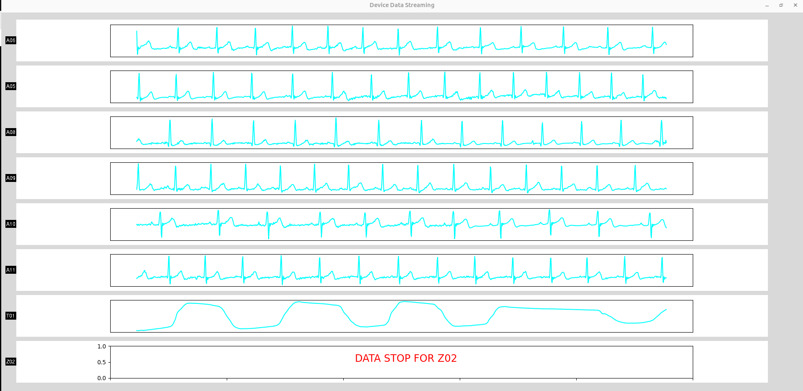

.. _user-guide:

==========
User Guide
==========

This section provides a step-by-step tutorial on how to use HeartSync.

1. Preparation
==============

Set the time (optional)
-----------------------
The "TimeSetter" Android app can be used to set the correct time, using the "setLocalTime" method from Polar's SDK. This android app follows the recommandation from `this github issue <https://github.com/polarofficial/polar-ble-sdk/issues/580>`_ :
    - Connect to the Polar H10 device
    - wait 7500s for service discovery to end
    - wait until the time is exactly at the second
    - send setLocalTime to the device

Configuration file
------------------
To run heart_sync.py you first need a csv configuration file. The expected format is:
    - the first line should be a header with the following fields: POLAR_ID,POLAR_SN,QUIT_PORT,TRIGGER_PORT,OUTPUT_FILE,DONGLE_MAC
    - POLAR_ID is an arbitrary ID given to the polar device,
    - POLAR_SN is the serial number of the polar device,
    - TRIGGER_PORT is an available port on the computer used to run the software. This port will be used to send a trigger via UDP to signal an event occuring during the stream. The trigger port need to be different for each polar_id listed.
    - QUIT_PORT is an available port on the computer used to run the software. This port will be used to send a trigger via UDP to stop the stream. The quit_port needs to be different for each polar_id listed.
    - OUTPUT_FILE is the name given to the text file in which the ECG stream is written,
    - DONGLE_MAC can be used to specify the MAC address of the bluetooth dongle used to receive the ECG stream on the computer. The dongle_mac can be the same for multiple polar_id, but should not exceed the limit of devices that can be connected to this dongle (usually the limit is around 7 devices max).
    

2. Data streaming
=================

Pairing the Polar device (for windows only)
-------------------------------------------

If your computer is running Windows 11, you first need to pair the Polar device with the computer before being able to launch a stream.
To do this, first make sure the Polar device is turned on, then

    - go to Settings > Devices > Bluetooth & other devices,
    - select Add Bluetooth or other device
    - select the Polar device with the correct Serial number

Start the stream
----------------
* To launch a stream on a Polar device, this device must be listed in the configuration file, with both its serial number and an arbitrary ID (for example "A03").
* Once the configuration file config.csv is filled, you can launch the stream in a terminal window, from the root folder of this package, using::

    python heart_sync/heart_sync.py -c config.csv -p A03

* You can use one configuration file to list multiple polar devices, in that case you can then run several stream by using the command above in separate terminal windows, one for each polar device. 
* heart_sync.py records everything (connection, disconnection, triggers..) into a file called experiment.log

Visualise data (optional)
-------------------------
* While one or several stream are ongoing, ecg_visualiser.py can be used to plot in real time all the streams. To use it::

    python ecg_visualiser.py

* When a stream stops for more than 1 second, the plot will instead display "DATA STOP FOR " with the ID of the polar device concerned. 

   Example of visualisation with 7 working ECG streams and one failing.

Mark events (optional)
----------------------
* In the root folder of the package, you can use trigger_sender.py to send event trigger or quit triggers to one ECG stream or to all streams.
* To send an event trigger to polar device with ID A03::

    python trigger_sender.py -c config.csv -p A03 

* To send an event trigger to all devices::

    python trigger_sender.py -c config.csv -p ALL 

Stop the stream
---------------
* To send a quit trigger to device A03::

    python trigger_sender.py -c config.csv -p A03 -q 

* To send an event trigger (or quit trigger) to all devices::

    python trigger_sender.py -c config.csv -p ALL -q 

Archive data (optional)
-----------------------
* At the start or end of the recording session, you can run::

    python start_experiment.py

* start_experiment.py archives the experiment log file and empties the local configuration file used by the visualisation utility.

3. Data decoding
================

Read the output file
--------------------
* The output file for ECG measures is in csv format. Each line of the file corresponds to one data package sent by the Polar H10 device.

* The csv file contains no header, the columns are the following: 
    - The first column is the package timestamp (in nanoseconds), sent by the polar H10 device. See `this documentation <https://github.com/polarofficial/polar-ble-sdk/blob/master/documentation/TimeSystemExplained.md>`_ for more info on the device timestamps.

    - The second column is the computer timestamp indicating the Unix Time (in seconds) when the package was received. 

    - The third column is the trigger, its values are 1 if a trigger was sent, 0 otherwise.

    - The rest of the columns are the ecg package sent by the polar H10 device

Resample data (optional)
------------------------
resampler.py can be used to force the raw ecg signal to a fixed sampling rate of exactly 130 HZ: 
    - we estimate the sampling rate for each data packet by taking the time 
      between previous and current timestamp (we assume the sampling rate to be
      constant for one packet and the timestamp to be correct)
    - we use a spline resampling to resample the signal to a fixed 130Hz
